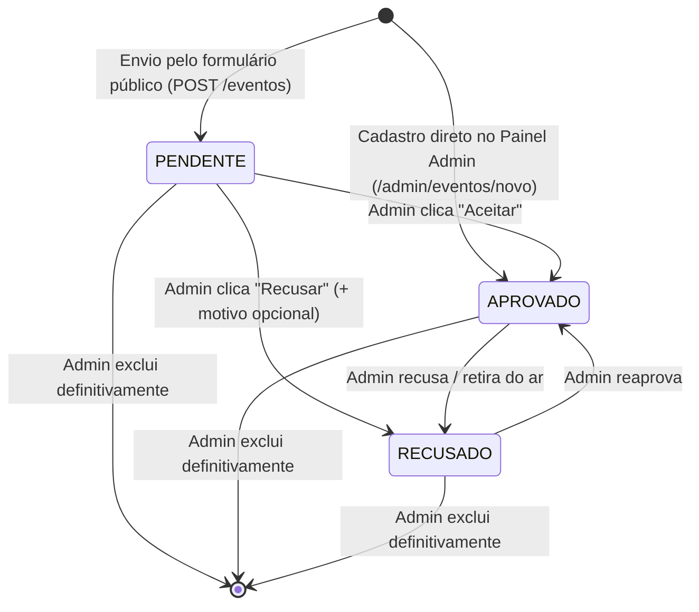

# Análise e Especificação: CRUD e Moderação de Eventos

Este documento registra toda a especificação funcional e técnica necessária para implementar a persistência em banco de dados, o envio público pelo formulário de [`src/main/resources/templates/eventos.html`](../src/main/resources/templates/eventos.html), a listagem pública dinâmica de eventos aprovados e o fluxo completo de moderação e gestão administrativa (**Aceitar**, **Recusar**, **Cadastrar**, **Editar** e **Excluir**) no painel `/admin/eventos`.

A especificação segue fielmente a arquitetura do projeto (`com.armamentobelico.portalarmamentobelico` — Java 21, Spring Boot 4.2, Spring Data JDBC, SQLite, Thymeleaf e Spring Security), mantendo total coerência com [`docs/crud-edicao-fanzine.md`](./crud-edicao-fanzine.md) e [`docs/crud-noticia.md`](./crud-noticia.md).

---

## 1. Diagnóstico do Estado Atual e Escopo

### 1.1. Estado Atual do Repositório
Atualmente:
- O template [`eventos.html`](../src/main/resources/templates/eventos.html) contém toda a interface da agenda pública:
  - Bloco de diretrizes obrigatórias (`.events-rules-box`): apenas música extrema, sem bandas cristãs, restrição a eventos beneficentes de caridade cristã e aprovação manual obrigatória pelo editor.
  - Barra de filtros (`#events-filter-form`) por Estado (`UF`, 27 estados brasileiros) e status temporal (`all`, `upcoming`, `past`), além do indicador de contagem (`#events-count-indicator`) e CTA `#cadastrar-evento`.
  - Container da grade de eventos (`#events-grid`) e modal `<dialog id="flyer-dialog">` para ampliação do flyer.
  - Formulário público (`#event-submit-form`) com os campos: `title`, `flyer` (`type="file"`), `city`, `state`, `date`, `time`, `organizer_contact`, `publisher_whatsapp`, `publisher_role` (`organizer` / `helper`) e `rules_agree` (checkbox obrigatório).
- **Lacunas identificadas no frontend atual:**
  - `#event-submit-form` aponta para `action="#cadastrar-evento"`, sem `th:action="@{/eventos}"` e sem `enctype="multipart/form-data"`. O submit é interceptado em [`script.js`](../src/main/resources/static/js/script.js) (linhas 1796–1820), exibindo apenas uma mensagem simulada sem enviar dados ao backend.
  - `#events-filter-form` aponta para `action="eventos.html"` e a listagem em `#events-grid` é alimentada por um array estático `EVENTS_CATALOG` em [`script.js`](../src/main/resources/static/js/script.js) (linhas 1401–1462).
  - O protótipo de card em `script.js` (linhas 1588–1591) exibe `publisherWhatsapp` publicamente, o que deve ser removido da renderização pública para preservar a privacidade de quem cadastrou o evento.
  - Em [`layout.html`](../src/main/resources/templates/layout.html) (linha 15), o elemento `<body>` possui a classe fixa `page-home`, enquanto `initEventsPage()` em `script.js` (linha 1716) retorna imediatamente se `document.body.classList.contains('page-eventos')` for falso — na implementação, a inicialização deve verificar a presença dos elementos da página (`#events-grid` / `#event-submit-form`) ou passar a classe do body dinamicamente ao fragmento `layout`.
  - A imagem divisora na linha 19 de `eventos.html` usa caminho relativo `src="assets/images/divisor-edicoes.png"` em vez de `th:src="@{/assets/images/divisor-edicoes.png}"`.
- **Infraestrutura backend já disponível:**
  - SQLite (`armamentobelico.db`) inicializado via [`src/main/resources/schema.sql`](../src/main/resources/schema.sql), configurado em [`DatabaseConfig.java`](../src/main/java/com/armamentobelico/portalarmamentobelico/config/DatabaseConfig.java) e [`JdbcDialectConfig.java`](../src/main/java/com/armamentobelico/portalarmamentobelico/config/JdbcDialectConfig.java) (`UUID <-> String`, `Boolean <-> Integer`).
  - Entidades com `UUID` (`Persistable<UUID>`) seguindo o padrão de [`model/Admin.java`](../src/main/java/com/armamentobelico/portalarmamentobelico/model/Admin.java).
  - Utilitários de validação em [`utils/ValidationUtils.java`](../src/main/java/com/armamentobelico/portalarmamentobelico/utils/ValidationUtils.java).
  - Upload e conversão automática de imagens para **WebP** em [`service/FileUploadService.java`](../src/main/java/com/armamentobelico/portalarmamentobelico/service/FileUploadService.java) (limite `10MB` por arquivo / `30MB` por requisição configurado em [`application.properties`](../src/main/resources/application.properties)).
  - Segurança em [`SecurityConfig.java`](../src/main/java/com/armamentobelico/portalarmamentobelico/config/SecurityConfig.java) protegendo `/admin` e `/admin/**`, com CSRF ativo globalmente (`CsrfTokenInitializationFilter`), e rota pública `GET /eventos` em [`PublicPagesController.java`](../src/main/java/com/armamentobelico/portalarmamentobelico/controller/PublicPagesController.java).
- **Ainda não existem:**
  - Tabela `evento` em `schema.sql`.
  - Enums, model `Evento`, DTOs, `EventoRepository`, `EventoService`, `EventoPublicController` e `AdminEventoController`.
  - Telas administrativas em `templates/admin/eventos/`.
  - Exposição dos arquivos de upload via `/uploads/**` (`WebMvcConfig` + ajuste em `SecurityConfig.CsrfTokenInitializationFilter.shouldNotFilter`), compartilhada com Edições e Notícias.

### 1.2. Escopo Coberto por Este Documento
1. Persistência completa na tabela SQLite `evento` dos dados enviados pelo formulário de `eventos.html` (incluindo upload do flyer em `.webp`).
2. Fluxo de moderação no Painel Admin (`/admin/eventos`): **Aceitar**, **Recusar** (com motivo opcional e histórico mantido), **Cadastrar manualmente**, **Editar** e **Excluir** definitivamente (registro + imagem `.webp`).
3. Listagem pública dinâmica em `GET /eventos` exibindo **exclusivamente eventos com status `APROVADO`**, com filtros por UF e status temporal (`Vai acontecer` / `Já aconteceu`) e proteção de privacidade do WhatsApp de quem publicou.
4. Segurança do endpoint público `POST /eventos` (CSRF, separação de DTO contra *mass assignment*, validação de arquivo e proteção básica anti-spam).

---

## 2. Regras de Negócio e Fluxo de Moderação

### 2.1. Ciclo de Vida e Estados de Moderação (`StatusModeracaoEvento`)


1. **Submissão Pública Sempre `PENDENTE`:**
   - Todo evento enviado por visitantes em `POST /eventos` é salvo obrigatoriamente com `status_moderacao = 'PENDENTE'`.
   - Eventos `PENDENTE` ou `RECUSADO` **nunca** aparecem na listagem pública `/eventos`.
2. **Aprovação (`APROVADO`):**
   - Ao clicar em **Aceitar** no painel admin, o status passa para `APROVADO`, limpa-se eventual `motivo_recusa`, e registram-se `moderado_em` (timestamp UTC ISO-8601) e `moderado_por` (username do admin autenticado via `Principal` / `Authentication`).
   - O evento passa a ser exibido imediatamente na agenda pública `/eventos`.
3. **Recusa (`RECUSADO`):**
   - Ao clicar em **Recusar** no painel admin, o registro **permanece no banco** com `status_moderacao = 'RECUSADO'` para histórico de moderação, podendo registrar um `motivo_recusa` opcional (ex.: *"Banda cristã"*, *"Fora da proposta de música extrema"*, *"Flyer ilegível"*).
   - Registra `moderado_em` e `moderado_por`.
   - Um evento recusado pode ser editado, re-aprovado posteriormente ou excluído definitivamente.
4. **Cadastro Direto no Painel Admin:**
   - O administrador pode cadastrar um evento diretamente em `/admin/eventos/novo`.
   - Eventos cadastrados pelo admin nascem com `status_moderacao = 'APROVADO'` por padrão (com opção no formulário de salvar como `PENDENTE` ou `RECUSADO` se desejar), `aceitou_regras = true`, `moderado_em` e `moderado_por` preenchidos automaticamente.
5. **Edição e Exclusão Definitiva:**
   - O administrador pode editar qualquer campo de um evento (título, flyer, cidade, UF, data, horário, contatos, papel do publicador, status e motivo de recusa). Se enviar um novo flyer, o arquivo `.webp` anterior é removido do disco via `FileUploadService.removerImagem`.
   - Ao **Excluir** definitivamente no admin, o registro é deletado da tabela `evento` **e** o arquivo `.webp` do flyer é removido do diretório de uploads.

### 2.2. Privacidade dos Dados de Contato
- **`contato_organizador`:** É um dado **público** — exibido no card do evento em `/eventos` (ex.: telefone/WhatsApp da produtora, e-mail ou `@instagram`) para que o público obtenha informações sobre ingressos e local.
- **`whatsapp_publicador`:** É um dado **restrito ao Painel Admin** — utilizado exclusivamente pelo editor para validar a autenticidade da divulgação junto a quem enviou o formulário. **Não deve ser renderizado** no HTML público de `eventos.html` nem exposto em atributos `data-*` da página pública.
- **`papel_publicador`:** Identifica se quem submeteu é o organizador (`ORGANIZADOR`) ou apenas ajudando na divulgação (`AJUDANTE`). Visível no painel admin para apoiar a moderação (opcionalmente oculto no card público para manter foco no evento).

### 2.3. Status Temporal Automático e Ordenação
- Fuso horário de referência do portal: **`America/Sao_Paulo`** (eventos do underground nacional).
- **Regra de transição:**
  - `data_evento >= hoje` → **"Vai acontecer"** (`upcoming`). No próprio dia do show, o evento ainda consta como futuro/ativo.
  - `data_evento < hoje` → **"Já aconteceu"** (`past`). A partir das 00:00 do dia seguinte à `data_evento`, muda automaticamente de badge e posição na lista.
- **Regra de ordenação pública (`GET /eventos`):**
  1. Primeiro, eventos futuros (`data_evento >= hoje`), ordenados por `data_evento ASC, horario ASC` (mais próximo primeiro).
  2. Em seguida, eventos passados (`data_evento < hoje`), ordenados por `data_evento DESC, horario DESC` (mais recente primeiro).

### 2.4. Regras de Validação e Proteção Anti-Spam (`POST /eventos`)
- **Título (`titulo`):** obrigatório, entre `3` e `120` caracteres (após `trim`).
- **Flyer (`flyer`):** obrigatório no envio público (e na criação admin); opcional na edição admin (mantém o atual se não enviado). Deve ser imagem válida (`image/jpeg`, `image/png`, `image/webp`, `image/gif`), respeitando o limite de `10MB` e convertido para `.webp` via `FileUploadService`.
- **Cidade (`cidade`):** obrigatória, entre `2` e `100` caracteres.
- **Estado (`estado`):** obrigatório, deve pertencer estritamente às 27 UFs brasileiras (`EstadoBrasil`).
- **Data (`dataEvento`):** obrigatória, formato ISO `yyyy-MM-dd` (`LocalDate`). No envio público, recomenda-se não aceitar datas muito antigas ou inválidas (ex.: impedir datas anteriores à data atual na submissão pública, enquanto o admin pode editar/cadastrar datas passadas para arquivo histórico).
- **Horário (`horario`):** obrigatório, formato `HH:mm` (`LocalTime`).
- **Contato do Organizador (`contatoOrganizador`):** obrigatório, entre `3` e `150` caracteres.
- **WhatsApp de quem publica (`whatsappPublicador`):** obrigatório, `10` a `20` caracteres contendo apenas dígitos/separadores (`[\d\s\(\)\+\-]+`) e **mínimo de 10 dígitos numéricos** (DDD + número).
- **Papel de quem publica (`papelPublicador`):** obrigatório (`organizer` → `ORGANIZADOR`, `helper` → `AJUDANTE`).
- **Aceite das diretrizes (`aceitouRegras`):** obrigatório (`true`) no envio público. Se `false` ou ausente, rejeita o envio.
- **Segurança no endpoint público `POST /eventos`:**
  - **CSRF obrigatório:** Como o formulário usa `th:action="@{/eventos}"` e `SecurityConfig` inicializa o token CSRF, requisições sem token válido são rejeitadas automaticamente (`403`).
  - **Honeypot simples anti-bot:** Campo oculto via CSS (ex.: `name="website"`, fora do foco por teclado com `tabindex="-1"` e `autocomplete="off"`). Se vier preenchido, o controller descarta silenciosamente ou retorna erro sem salvar arquivo no disco.
  - **Proteção contra *Mass Assignment*:** `POST /eventos` faz bind exclusivamente em `EventoPublicFormDTO`, que **não possui** `statusModeracao`, `motivoRecusa`, `moderadoEm` nem `moderadoPor`.
  - **Limite básico de envios por IP (recomendado):** Limitar submissões públicas (ex.: máximo 5 envios por IP em janela de 15 minutos em memória) para evitar abuso de disco com uploads de flyers.

---

## 3. Mapeamento Completo de Dados (`eventos.html` → Banco)

### 3.1. Tabela `evento`
| Campo Java | Coluna SQLite | Tipo Java / SQLite | Obrigatório | Origem (`eventos.html` / Admin) e Uso |
| :--- | :--- | :--- | :---: | :--- |
| `id` | `id` | `UUID` (`TEXT` PK) | Sim | Identificador único (padrão `Persistable<UUID>`, como em `Admin.java`) |
| `titulo` | `titulo` | `String` (`TEXT`) | Sim | `<input id="ev-title" name="title">` (3–120 chars); título no card e lightbox |
| `flyerPath` | `flyer_path` | `String` (`TEXT`) | Sim | `<input id="ev-flyer" name="flyer">`; nome do `.webp` salvo pelo `FileUploadService` (exibido via `/uploads/{flyerPath}`) |
| `cidade` | `cidade` | `String` (`TEXT`) | Sim | `<input id="ev-city" name="city">`; exibido em `Cidade / UF` |
| `estado` | `estado` | `EstadoBrasil` (`TEXT`) | Sim | `<select id="ev-state" name="state">`; sigla UF de 2 letras (`AC`..`TO`); usado no filtro público e admin |
| `dataEvento` | `data_evento` | `LocalDate` (`TEXT` `yyyy-MM-dd`) | Sim | `<input id="ev-date" name="date">`; determina `Vai acontecer` / `Já aconteceu` e ordenação |
| `horario` | `horario` | `String` (`TEXT` `HH:mm`) | Sim | `<input id="ev-time" name="time">`; horário de início exibido no card |
| `contatoOrganizador` | `contato_organizador` | `String` (`TEXT`) | Sim | `<input id="ev-organizer-contact" name="organizer_contact">`; **público** no card |
| `whatsappPublicador` | `whatsapp_publicador` | `String` (`TEXT`) | Sim | `<input id="ev-publisher-whatsapp" name="publisher_whatsapp">`; **somente Admin** |
| `papelPublicador` | `papel_publicador` | `PapelPublicador` (`TEXT`) | Sim | `<input type="radio" name="publisher_role">` (`organizer` → `ORGANIZADOR`, `helper` → `AJUDANTE`) |
| `aceitouRegras` | `aceitou_regras` | `Boolean` (`INTEGER` `0`/`1`) | Sim | `<input id="ev-rules-agree" name="rules_agree">`; confirmação explícita das diretrizes |
| `statusModeracao` | `status_moderacao` | `StatusModeracaoEvento` (`TEXT`) | Sim | `PENDENTE` (público), `APROVADO` (visível no site), `RECUSADO` (histórico admin) |
| `motivoRecusa` | `motivo_recusa` | `String` (`TEXT`) | Não | Observação opcional registrada pelo admin ao recusar o evento |
| `moderadoEm` | `moderado_em` | `String` (`TEXT` ISO-8601) | Não | Data/hora da última aprovação ou recusa |
| `moderadoPor` | `moderado_por` | `String` (`TEXT`) | Não | Username do administrador que aprovou ou recusou |
| `criadoEm` | `criado_em` | `String` (`TEXT` ISO-8601) | Sim (auto) | Data/hora do envio/criação |
| `atualizadoEm` | `atualizado_em` | `String` (`TEXT` ISO-8601) | Sim (auto) | Data/hora da última alteração |

### 3.2. Enums Recomendados (`model/enums/` ou `model/`)
- **`StatusModeracaoEvento`:**
  - `PENDENTE` — *"Aguardando aprovação"*
  - `APROVADO` — *"Aprovado (Publicado)"*
  - `RECUSADO` — *"Recusado"*
- **`PapelPublicador`:**
  - `ORGANIZADOR` — *"Organizador do evento"* (mapeia valor `"organizer"` do formulário público)
  - `AJUDANTE` — *"Apenas ajudando na divulgação"* (mapeia valor `"helper"` do formulário público)
- **`EstadoBrasil`:**
  - `AC`, `AL`, `AP`, `AM`, `BA`, `CE`, `DF`, `ES`, `GO`, `MA`, `MT`, `MS`, `MG`, `PA`, `PB`, `PR`, `PE`, `PI`, `RJ`, `RN`, `RS`, `RO`, `RR`, `SC`, `SP`, `SE`, `TO` (com propriedade `nome` para renderizar `SP - São Paulo` dinamicamente via Thymeleaf nos `<select>`).

---

## 4. Estrutura de Banco de Dados (`schema.sql`)

### 4.1. Tabela `evento` em `src/main/resources/schema.sql`
```sql
CREATE TABLE IF NOT EXISTS evento (
    id TEXT PRIMARY KEY,
    titulo TEXT NOT NULL,
    flyer_path TEXT NOT NULL,
    cidade TEXT NOT NULL,
    estado TEXT NOT NULL CHECK (estado IN (
        'AC','AL','AP','AM','BA','CE','DF','ES','GO','MA','MT','MS','MG',
        'PA','PB','PR','PE','PI','RJ','RN','RS','RO','RR','SC','SP','SE','TO'
    )),
    data_evento TEXT NOT NULL,              -- ISO yyyy-MM-dd (permite comparação lexicográfica nativa no SQLite)
    horario TEXT NOT NULL,                  -- HH:mm
    contato_organizador TEXT NOT NULL,
    whatsapp_publicador TEXT NOT NULL,      -- Restrito ao painel admin
    papel_publicador TEXT NOT NULL CHECK (papel_publicador IN ('ORGANIZADOR', 'AJUDANTE')),
    aceitou_regras INTEGER NOT NULL DEFAULT 1 CHECK (aceitou_regras IN (0, 1)),
    status_moderacao TEXT NOT NULL DEFAULT 'PENDENTE'
        CHECK (status_moderacao IN ('PENDENTE', 'APROVADO', 'RECUSADO')),
    motivo_recusa TEXT,
    moderado_em TEXT,
    moderado_por TEXT,
    criado_em TEXT NOT NULL,
    atualizado_em TEXT NOT NULL
);

CREATE INDEX IF NOT EXISTS idx_evento_status_data
    ON evento (status_moderacao, data_evento);

CREATE INDEX IF NOT EXISTS idx_evento_estado_status_data
    ON evento (estado, status_moderacao, data_evento);
```

> **Nota sobre SQLite e Datas:** Como `data_evento` é armazenado no formato ISO-8601 `yyyy-MM-dd` (`LocalDate`) e `horario` em `HH:mm`, a ordenação e a comparação (`data_evento >= :hoje` e `data_evento < :hoje`) funcionam de forma exata e indexável diretamente no SQLite.

---

## 5. Arquitetura Backend (Java / Spring Boot / Spring Data JDBC)

### 5.1. Model (`model/Evento.java`)
Segue o padrão já adotado em [`Admin.java`](../src/main/java/com/armamentobelico/portalarmamentobelico/model/Admin.java):
- `@Table("evento")`
- Implementa `Persistable<UUID>` com `@Id private UUID id;` e `@Transient private boolean isNew = false;` (`isNew()` retorna `isNew || id == null`).
- Método auxiliar de domínio (não persistido) para facilitar o Thymeleaf:
  - `public boolean isPassado(LocalDate hoje)`: retorna `dataEvento != null && dataEvento.isBefore(hoje)`.
  - `public String getWhatsappPublicadorSomenteDigitos()`: útil no painel admin para montar o link direto `https://wa.me/55...` de validação.

### 5.2. Repositório (`repository/EventoRepository.java`)
Estende `CrudRepository<Evento, UUID>` com queries SQL explícitas:

- **Agenda Pública (`status_moderacao = 'APROVADO'`):**
  - `findAprovadosOrdenados(String hojeIso, String estado, String statusTemporal)`:
    - Filtra sempre `status_moderacao = 'APROVADO'`.
    - Quando `estado` não for nulo nem `"all"`, aplica `AND estado = :estado`.
    - Quando `statusTemporal` for `"upcoming"`, aplica `AND data_evento >= :hojeIso`.
    - Quando `statusTemporal` for `"past"`, aplica `AND data_evento < :hojeIso`.
    - Ordenação SQL exata:
      ```sql
      ORDER BY
        CASE WHEN data_evento >= :hojeIso THEN 0 ELSE 1 END ASC,
        CASE WHEN data_evento >= :hojeIso THEN data_evento END ASC,
        CASE WHEN data_evento >= :hojeIso THEN horario END ASC,
        CASE WHEN data_evento <  :hojeIso THEN data_evento END DESC,
        CASE WHEN data_evento <  :hojeIso THEN horario END DESC
      ```
- **Painel Admin:**
  - `findParaAdmin(String statusModeracao, String estado)`:
    - Permite filtrar por `PENDENTE`, `APROVADO`, `RECUSADO` ou todos (`null`/`"ALL"`), e opcionalmente por `estado` (UF).
    - Ordenação padrão no admin: `PENDENTE` primeiro (mais antigos primeiro para fila FIFO de aprovação, ou mais recentes), seguido pelos demais por `criado_em DESC`.
  - `countByStatusModeracao(StatusModeracaoEvento status)`:
    - Exibe contadores nas abas do painel (`Pendentes (3)`, `Aprovados (12)`, `Recusados (2)`) e badge de alerta no dashboard `/admin`.

### 5.3. DTOs (`dto/`)
Separar explicitamente entrada pública e administrativa impede *mass assignment*:

1. **`EventoPublicFormDTO`** (usado em `POST /eventos`):
   - `title` (`String`)
   - `flyer` (`MultipartFile`)
   - `city` (`String`)
   - `state` (`String`)
   - `date` (`LocalDate`, `@DateTimeFormat(iso = DateTimeFormat.ISO.DATE)`)
   - `time` (`String`)
   - `organizerContact` (`String`, mapeando `organizer_contact` ou padronizando `name` no template)
   - `publisherWhatsapp` (`String`)
   - `publisherRole` (`String`: `"organizer"` ou `"helper"`)
   - `rulesAgree` (`boolean`)
   - `website` (`String` — campo honeypot anti-bot, deve estar vazio)

2. **`EventoAdminFormDTO`** (usado em `/admin/eventos/novo` e `/admin/eventos/{id}/editar`):
   - Todos os campos editáveis do evento (`titulo`, `flyer` [`MultipartFile` opcional na edição], `cidade`, `estado`, `dataEvento`, `horario`, `contatoOrganizador`, `whatsappPublicador`, `papelPublicador`, `statusModeracao`, `motivoRecusa`).
   - Campo somente leitura para exibição no form de edição: `flyerPathAtual`.

3. **`EventoPublicCardDTO`** (opcional, recomendado para renderização em `eventos.html`):
   - Projeção segura contendo apenas `id`, `titulo`, `flyerUrl` (`/uploads/{flyerPath}`), `cidade`, `estado`, `dataEvento`, `dataFormatada` (`dd/MM/yyyy`), `horario`, `contatoOrganizador` e `passado` (`boolean`).
   - Garante por design que `whatsappPublicador`, `motivoRecusa`, `moderadoPor` etc. **jamais** vazem para o HTML público.

### 5.4. Serviço (`service/EventoService.java`)
Responsável por todas as regras de negócio, validações (usando `ValidationUtils` + validações específicas de UF, horário `HH:mm`, telefone com ≥10 dígitos, imagem e aceite de regras) e orquestração transacional com `FileUploadService`:

| Método | Responsabilidade |
| :--- | :--- |
| `submeterEventoPublico(EventoPublicFormDTO dto)` | Valida honeypot, campos obrigatórios, `rulesAgree == true`, `date >= hoje` (fuso `America/Sao_Paulo`), UF válida, WhatsApp ≥10 dígitos e arquivo de imagem; salva flyer `.webp` via `FileUploadService.salvarImagem`; persiste com `statusModeracao = PENDENTE`, `criadoEm` e `atualizadoEm`. Em caso de falha na persistência, remove o `.webp` recém-salvo (evita arquivo órfão). |
| `criarEventoAdmin(EventoAdminFormDTO dto, String adminUsername)` | Valida campos e imagem obrigatória; salva flyer `.webp`; persiste com status escolhido (padrão `APROVADO`), `aceitouRegras = true`, `moderadoPor = adminUsername` e `moderadoEm = now`. |
| `atualizarEventoAdmin(UUID id, EventoAdminFormDTO dto, String adminUsername)` | Busca evento existente (lança exceção se não encontrado); valida campos; se novo flyer for enviado, salva novo `.webp` e remove o antigo após sucesso; atualiza `moderadoEm`/`moderadoPor` se o status mudar; limpa `motivoRecusa` se status != `RECUSADO`; salva com `isNew = false`. |
| `aprovar(UUID id, String adminUsername)` | Altera `statusModeracao = APROVADO`, define `motivoRecusa = null`, registra `moderadoEm`, `moderadoPor` e `atualizadoEm`. |
| `recusar(UUID id, String motivoRecusa, String adminUsername)` | Altera `statusModeracao = RECUSADO`, grava `motivoRecusa` (trim, opcional, até 500 chars), registra `moderadoEm`, `moderadoPor` e `atualizadoEm`. |
| `excluir(UUID id)` | Busca o evento, exclui o registro do banco e chama `FileUploadService.removerImagem(evento.getFlyerPath())`. |
| `listarAprovadosPublico(String estado, String statusTemporal)` | Consulta `EventoRepository.findAprovadosOrdenados` usando `LocalDate.now(ZoneId.of("America/Sao_Paulo"))` e converte para `List<EventoPublicCardDTO>`. |
| `listarParaAdmin(String status, String estado)` | Retorna eventos filtrados para a tabela administrativa + mapa de contadores por status (`PENDENTE`, `APROVADO`, `RECUSADO`). |

### 5.5. Controllers e Rotas

#### A. Controller Público (`controller/EventoPublicController.java`)
*(Substituindo o método estático `@GetMapping("/eventos")` de [`PublicPagesController.java`](../src/main/java/com/armamentobelico/portalarmamentobelico/controller/PublicPagesController.java))*

| Método / Rota | Descrição |
| :--- | :--- |
| `GET /eventos` | Aceita parâmetros opcionais `?estado=SP&status=upcoming` (padrões `all` / `all`). Carrega `eventos` (`List<EventoPublicCardDTO>`), `estados` (`EstadoBrasil.values()`), `estadoSelecionado`, `statusSelecionado`, `totalEventos` e um `eventoForm` vazio (se não vier de flash attribute após erro de validação). Renderiza `eventos.html`. |
| `POST /eventos` | Recebe `multipart/form-data` (`EventoPublicFormDTO`). Em caso de sucesso, aplica padrão **PRG (Post/Redirect/Get)** redirecionando para `/eventos#cadastrar-evento` com flash attribute `eventoSucesso` (mensagem de confirmação: evento recebido e aguardando aprovação manual). Em caso de erro de validação, redireciona para `/eventos#cadastrar-evento` com `eventoErro` e preserva os dados digitados via flash attribute (exceto o arquivo). |

#### B. Controller Administrativo (`controller/AdminEventoController.java`)
Protegido automaticamente por `SecurityConfig` (`/admin/**` exige autenticação):

| Método / Rota | Descrição |
| :--- | :--- |
| `GET /admin/eventos` | Lista eventos com filtros `?status=PENDENTE|APROVADO|RECUSADO|TODOS` (padrão `PENDENTE` se houver pendentes, ou `TODOS`) e `?estado=UF`. Exibe contadores por status. Renderiza `admin/eventos/lista.html`. |
| `GET /admin/eventos/novo` | Exibe formulário de cadastro direto pelo admin (`admin/eventos/form.html`). |
| `POST /admin/eventos` | Cria evento direto pelo admin (`multipart/form-data`, `APROVADO` por padrão) e redireciona para `/admin/eventos`. |
| `GET /admin/eventos/{id}/editar` | Carrega evento pelo `UUID` e exibe `admin/eventos/form.html` preenchido. |
| `POST /admin/eventos/{id}` | Atualiza dados e opcionalmente substitui o flyer `.webp`. Redireciona para `/admin/eventos`. |
| `POST /admin/eventos/{id}/aprovar` | Aprova o evento (`statusModeracao = APROVADO`) e redireciona de volta ao filtro ativo com flash message de sucesso. |
| `POST /admin/eventos/{id}/recusar` | Recebe parâmetro opcional `motivoRecusa`, marca o evento como `RECUSADO` e redireciona com flash message. |
| `POST /admin/eventos/{id}/excluir` | Exclui definitivamente o evento do banco e remove o arquivo `.webp` do disco. Redireciona com flash message. |

> **Pré-requisito compartilhado (`/uploads/**`):** Assim como especificado em [`docs/crud-edicao-fanzine.md`](./crud-edicao-fanzine.md) e [`docs/crud-noticia.md`](./crud-noticia.md), os flyers salvos em `${upload.dir}` devem ser servidos via `WebMvcConfig` (`/uploads/**` → `file:${upload.dir}/`) e `/uploads/` deve constar em `SecurityConfig.CsrfTokenInitializationFilter.shouldNotFilter` para não criar sessão HTTP ao carregar imagens.

---

## 6. Frontend: Painel Admin e Página Pública (`/eventos`)

### 6.1. Painel Administrativo (`templates/admin/eventos/`)
1. **`templates/admin/index.html`:** Adicionar card/atalho **"Eventos"** com badge exibindo a quantidade atual de eventos `PENDENTE` aguardando aprovação.
2. **`templates/admin/eventos/lista.html`:**
   - Abas de filtro rápido por status com contadores: **Pendentes**, **Aprovados**, **Recusados**, **Todos**, além de filtro por **UF**.
   - Tabela/cards exibindo para cada registro:
     - Miniatura do flyer (`/uploads/{flyerPath}`) clicável para ampliação.
     - Título, Cidade/UF, Data (`dd/MM/yyyy`) e Horário, com indicador temporal (`Vai acontecer` / `Já aconteceu`).
     - Badge de moderação (`PENDENTE` amarelo, `APROVADO` verde, `RECUSADO` vermelho + motivo da recusa quando houver).
     - **Dados de validação (exclusivos do admin):** `Contato do Organizador`, `WhatsApp de quem publicou` (com link direto `https://wa.me/55...` para contato rápido) e `Papel` (`Organizador` ou `Ajudando na divulgação`).
     - **Ações (todas via `POST` com CSRF):**
       - **Aceitar** (exibido quando `PENDENTE` ou `RECUSADO`).
       - **Recusar** (exibido quando `PENDENTE` ou `APROVADO` — abre `<dialog>` simples ou campo inline para informar motivo opcional da recusa e confirmar).
       - **Editar** (link `GET /admin/eventos/{id}/editar`).
       - **Excluir** (botão `POST /admin/eventos/{id}/excluir` com confirmação explícita *"Excluir definitivamente o evento e seu flyer?"*).
3. **`templates/admin/eventos/form.html`:**
   - Formulário `multipart/form-data` reutilizado para criar e editar eventos:
     - Campos: Título, Flyer (com preview do flyer atual na edição + upload opcional para substituir), Cidade, Estado (`EstadoBrasil`), Data, Horário, Contato do Organizador, WhatsApp do Publicador, Papel do Publicador (`ORGANIZADOR` / `AJUDANTE`), Status de Moderação (`APROVADO` / `PENDENTE` / `RECUSADO`) e Motivo da Recusa (exibido/habilitado quando status = `RECUSADO`).

### 6.2. Refatoração da Página Pública (`templates/eventos.html` e `static/js/script.js`)
1. **`templates/eventos.html`:**
   - Corrigir divisor para `th:src="@{/assets/images/divisor-edicoes.png}"`.
   - Atualizar `#events-filter-form` para `th:action="@{/eventos}" method="GET"`, mantendo os `<select>` de `estado` e `status` selecionados conforme `estadoSelecionado` e `statusSelecionado` (com auto-submit ao alterar ou botão "Filtrar").
   - Renderizar `#events-grid` via Thymeleaf (`th:each="ev : ${eventos}"`) mantendo exatamente as classes CSS existentes (`.event-card`, `.is-past`, `.event-flyer-wrap`, `.event-status-badge`, `.event-flyer-btn`, `.event-card-body`, `.event-meta-list`), exibindo:
     - Badge temporal (`Vai acontecer` / `Já aconteceu`).
     - Flyer (`/uploads/{flyerPath}`) com `data-flyer-src` e `data-flyer-title` para o `<dialog id="flyer-dialog">`.
     - Título, Local (`Cidade / UF`), Data (`dd/MM/yyyy`), Horário e Contato do Organizador.
     - **Remover** o bloco `.event-publisher-info` com `WhatsApp de quem publicou` do card público.
   - Atualizar `#event-submit-form`:
     - `th:action="@{/eventos}" method="POST" enctype="multipart/form-data"` (CSRF injetado automaticamente pelo Thymeleaf).
     - Exibir banners de feedback reais (`eventoSucesso` e `eventoErro`) em `#event-submit-feedback` vindos do `RedirectAttributes`.
     - Adicionar campo honeypot visualmente oculto (`name="website"`, `aria-hidden="true"`, `tabindex="-1"`, `autocomplete="off"`).
2. **`static/js/script.js`:**
   - Remover o array hardcoded `EVENTS_CATALOG` e a renderização client-side `renderEventsList()`.
   - Alterar `initEventsPage()` para inicializar pela presença de `#events-grid` ou `#event-submit-form` (sem depender de `document.body.classList.contains('page-eventos')`, resolvendo o bug atual com `layout.html`).
   - **Manter** funcionando:
     - Lightbox do flyer (`<dialog id="flyer-dialog">`) usando delegação de clique em `#events-grid .event-flyer-btn`.
     - Pré-visualização local da imagem selecionada em `#ev-flyer` (`FileReader`).
     - Validação acessível (`setupAccessibleFormValidation(eventForm)`), bloqueando o submit (`e.preventDefault()`) **apenas quando `!eventForm.checkValidity()`** e deixando o submit real acontecer quando o formulário for válido.
     - Auto-submit opcional do `#events-filter-form` ao trocar `estado` ou `status` (`filterForm.submit()`).

---

## 7. Estratégia de Testes (TDD — Red → Green → Refactor)

Seguindo `AGENTS.md`, a implementação deve ser guiada por testes automatizados antes do código de produção em cada camada:

1. **Testes Unitários (`EventoServiceTest`):**
   - `submeterEventoPublico` força `statusModeracao = PENDENTE`, valida UF/WhatsApp/regras/honeypot e chama `FileUploadService.salvarImagem`.
   - Rejeita submissão pública quando `rulesAgree = false`, WhatsApp tem menos de 10 dígitos, UF é inválida ou imagem está vazia.
   - `aprovar` muda status para `APROVADO`, limpa `motivoRecusa` e preenche `moderadoPor` e `moderadoEm`.
   - `recusar` muda status para `RECUSADO`, persiste `motivoRecusa` opcional e preenche auditoria.
   - `atualizarEventoAdmin` mantém o flyer antigo quando nenhum novo arquivo é enviado, e remove o `.webp` antigo quando um novo flyer é enviado.
   - `excluir` deleta o registro do banco e invoca `FileUploadService.removerImagem`.
2. **Testes de Persistência (`EventoRepositoryTest` com SQLite em banco temporário):**
   - `findAprovadosOrdenados` retorna apenas `APROVADO` (ignora `PENDENTE` e `RECUSADO`).
   - Ordenação exata: eventos futuros (`>= hoje`) primeiro em ordem crescente de data/hora, seguidos pelos passados (`< hoje`) em ordem decrescente.
   - Filtros por `estado` (UF) e `statusTemporal` (`upcoming` / `past`).
   - `countByStatusModeracao` contabiliza corretamente cada status.
3. **Testes Web / Segurança (`EventoControllerTests` com `MockMvc`):**
   - `POST /eventos` público (sem login, com CSRF e multipart) retorna redirect `302` para `/eventos#cadastrar-evento` e salva evento como `PENDENTE` (mesmo que o cliente tente enviar `statusModeracao=APROVADO` na requisição).
   - `GET /eventos` retorna `200`, exibe apenas eventos `APROVADO` e **não contém** o `whatsappPublicador` no HTML renderizado.
   - `GET /admin/eventos` sem autenticação redireciona para `/?login=required`.
   - Com `@WithMockUser(roles = "ADMIN")`: testa `POST /admin/eventos/{id}/aprovar`, `POST /admin/eventos/{id}/recusar` (com motivo), `POST /admin/eventos` (criação direta `APROVADO`), `POST /admin/eventos/{id}` (edição) e `POST /admin/eventos/{id}/excluir` (com CSRF).
   - Preserva `AdminLoginSecurityTests` (`staticAssetRequestDoesNotCreateSession` incluindo `/uploads/`).

---

## 8. Ordem Recomendada de Implementação

- [ ] **Etapa 1 — Banco e Domínio:** Adicionar tabela `evento` + índices em `schema.sql`; criar enums (`StatusModeracaoEvento`, `PapelPublicador`, `EstadoBrasil`) e model `Evento` (`Persistable<UUID>`).
- [ ] **Etapa 2 — Repositório (TDD):** Escrever testes de `EventoRepository` (SQLite) e implementar queries de listagem pública ordenada, filtros e contadores admin.
- [ ] **Etapa 3 — Serviço e Uploads (TDD):** Garantir `WebMvcConfig` (`/uploads/**`) e exceção em `SecurityConfig`; escrever testes de `EventoService` e implementar submissão pública, cadastro/edição admin, aprovação, recusa e exclusão com limpeza de `.webp`.
- [ ] **Etapa 4 — Painel Admin (`/admin/eventos`) (TDD):** Criar `EventoAdminFormDTO`, `AdminEventoController`, `admin/eventos/lista.html`, `admin/eventos/form.html` e atalho com contador de pendentes em `admin/index.html`; validar via `MockMvc`.
- [ ] **Etapa 5 — Página Pública (`/eventos`) (TDD):** Criar `EventoPublicFormDTO`, `EventoPublicCardDTO` e `EventoPublicController`; remover rota estática de `PublicPagesController`; atualizar `eventos.html` e `script.js` (renderização Thymeleaf, submit real multipart + CSRF, privacidade do WhatsApp e lightbox funcional); validar via `MockMvc`.
