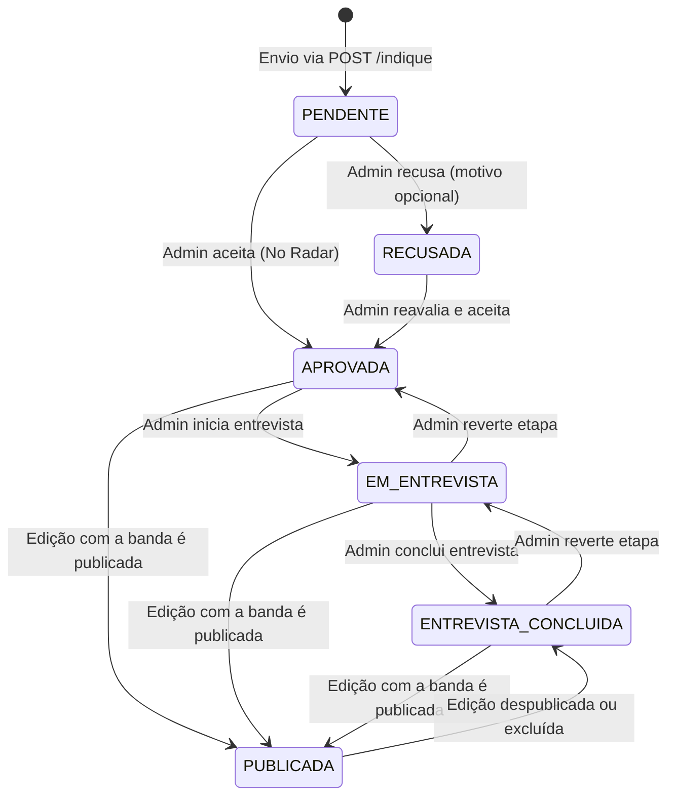

# Análise e Especificação: CRUD e Fluxo de Curadoria de Indicação de Bandas (`indique.html`)

Este documento registra toda a especificação funcional e técnica necessária para implementar a persistência, verificação inteligente de bandas já entrevistadas, tratamento de homônimos, curadoria editorial e baixa automática integrada às edições do fanzine para **Indicação de Bandas** no portal **Armamento Bélico**, tomando como base o template [`src/main/resources/templates/indique.html`](../src/main/resources/templates/indique.html), o comportamento atual em [`src/main/resources/static/js/script.js`](../src/main/resources/static/js/script.js), o fluxo de edições especificado em [`docs/crud-edicao-fanzine.md`](./crud-edicao-fanzine.md) e a arquitetura já existente no projeto (`com.armamentobelico.portalarmamentobelico` — Spring Boot 4.2, Java 21, Spring Data JDBC, SQLite, Thymeleaf e Spring Security).

---

## 1. Diagnóstico do Estado Atual e Escopo

### 1.1. Estado Atual do Repositório
Atualmente:
- O template [`indique.html`](../src/main/resources/templates/indique.html) possui:
  - Bloco de critérios editoriais (`.events-rules-box`) — material físico lançado, sonoridade extrema e verificação de duplicidade.
  - Formulário público `#band-suggest-form` com 5 campos: `band_name`, `country` (com `<datalist id="band-countries-list">`), `region` (opcional), `release_title` e `listen_url`.
  - Seção pública **Hordas Já Indicadas** (`#indicated-bands-grid` e contador `#indicated-bands-count`), atualmente preenchida no navegador via `localStorage` (`ab_band_indications_v1`) com a lista mock `BAND_INDICATIONS_SEED` (`Diabolizer`, `Coldwinter`, `Mortem Solis`).
- **Problemas estruturais encontrados nos arquivos atuais (a corrigir na implementação):**
  1. **`indique.html` (linha 18):** utiliza caminho relativo `src="assets/images/divisor-edicoes.png"` em vez de `th:src="@{/assets/images/divisor-edicoes.png}"`.
  2. **`layout.html` (linha 15) × `script.js` (linha 1960):** `layout.html` fixa `<body class="page-home">`, enquanto `initIndiquePage()` executa `if (!document.body.classList.contains('page-indique')) return;`, fazendo a inicialização da página retornar imediatamente sem ativar validação nem eventos no Thymeleaf atual. Na implementação, `initIndiquePage()` deve detectar a página pela presença de `#band-suggest-form` / `#indicated-bands-grid` (ou `layout.html` deve receber `bodyClass` dinâmico).
  3. **`indique.html` (linha 59):** `#band-suggest-form` possui `action="#indicar-banda"`, não envia token CSRF do Spring Security e depende de `e.preventDefault()` em `script.js` para simular o cadastro em `localStorage`.
  4. **`PublicPagesController.java` (linhas 34–36):** `GET /indique` retorna `"indique"` sem consultar o banco nem disponibilizar `POST /indique` ou endpoint de verificação em tempo real.
- O backend já possui:
  - Banco **SQLite** (`armamentobelico.db`) inicializado via [`src/main/resources/schema.sql`](../src/main/resources/schema.sql) e configurado em [`DatabaseConfig.java`](../src/main/java/com/armamentobelico/portalarmamentobelico/config/DatabaseConfig.java) e [`JdbcDialectConfig.java`](../src/main/java/com/armamentobelico/portalarmamentobelico/config/JdbcDialectConfig.java) (conversores prontos `UUID <-> String` e `Boolean <-> Integer`).
  - Padrão de entidades com `UUID` (`Persistable<UUID>`) em [`model/Admin.java`](../src/main/java/com/armamentobelico/portalarmamentobelico/model/Admin.java).
  - Segurança configurada em [`SecurityConfig.java`](../src/main/java/com/armamentobelico/portalarmamentobelico/config/SecurityConfig.java) protegendo `/admin` e `/admin/**` com login baseado em sessão e proteção CSRF (`CsrfTokenInitializationFilter`).
  - Utilitários de validação em [`utils/ValidationUtils.java`](../src/main/java/com/armamentobelico/portalarmamentobelico/utils/ValidationUtils.java).
- Ainda **não existem**:
  - Tabela `indicacao_banda` no `schema.sql` nem coluna opcional `indicacao_banda_id` em `edicao_entrevista` (e ativação de `PRAGMA foreign_keys = ON` no `DatabaseConfig.java`).
  - Enum `StatusIndicacaoBanda`, entidade `IndicacaoBanda`, DTOs, `IndicacaoBandaRepository`, `IndicacaoBandaService`, endpoint `GET /api/indicacoes/verificar` e telas administrativas em `templates/admin/indicacoes/`.

### 1.2. Escopo desta Especificação (End-to-End)
1. **Fluxo Público (`/indique` e `/api/indicacoes/verificar`):**
   - Cadastro de indicações **exclusivamente pelo formulário público** em `/indique`.
   - Verificação em tempo real (durante o preenchimento/busca) e validação obrigatória no servidor ao submeter (`POST /indique`), identificando se a banda já foi **entrevistada em alguma edição publicada** (informando o número da edição e link) ou se **já está indicada/no radar**.
   - Fluxo de **esclarecimento de homônimo** quando o visitante indicar uma banda com o mesmo nome no mesmo país de uma banda já entrevistada ou já indicada.
   - Vitrine pública **Hordas Já Indicadas** exibindo **somente bandas aceitas** (`APROVADA`, `EM_ENTREVISTA`, `ENTREVISTA_CONCLUIDA`) com badge da etapa atual, ocultando `PENDENTE`, `RECUSADA` e `PUBLICADA`.
2. **Fluxo Administrativo (`/admin/indicacoes`):**
   - Moderação e acompanhamento da fila editorial: **Aceitar** (`APROVADA`), **Recusar** (`RECUSADA`), marcar **Em processo de entrevista** (`EM_ENTREVISTA`), marcar **Entrevista concluída** (`ENTREVISTA_CONCLUIDA`), reverter etapa se necessário, **Editar** dados (correção de grafia/link) e **Excluir** permanentemente (ex.: spam).
   - **Sem** tela de criação manual no admin (entrada ocorre apenas via formulário público).
3. **Integração com Publicação de Edições (`EdicaoService`):**
   - Vínculo híbrido: seleção opcional de indicações aceitas/concluídas ao cadastrar entrevistas em uma edição + correspondência automática por `(banda, país)` normalizados quando a edição for publicada (`publicado = 1`), transicionando a indicação para `PUBLICADA` e removendo-a imediatamente da vitrine pública de `/indique`.

---

## 2. Regras de Negócio da Curadoria, Verificação e Homônimos

### 2.1. Entrada Exclusiva pelo Formulário Público
- Toda nova indicação entra no sistema exclusivamente por `POST /indique` com status inicial **`PENDENTE`**.
- Não existe rota `/admin/indicacoes/nova` no painel administrativo. Bandas que o editor decide entrevistar por iniciativa própria (sem indicação prévia de leitores) são cadastradas diretamente na tabela `edicao_entrevista` da respectiva edição — e, ainda assim, serão detectadas automaticamente na verificação de `/indique` assim que essa edição for publicada.

### 2.2. Máquina de Estados (`StatusIndicacaoBanda`)



| Status (`StatusIndicacaoBanda`) | Rótulo Admin | Visível em `/indique`? | Badge Público em `/indique` (PT / EN) | Descrição |
| :--- | :--- | :---: | :--- | :--- |
| `PENDENTE` | Pendente | **Não** | — | Recém-enviada pelo formulário público; aguarda avaliação do admin. |
| `RECUSADA` | Recusada | **Não** | — | Recusada pelo admin (mantida no histórico com `motivo_recusa` opcional; pode ser reavaliada/aceita depois). |
| `APROVADA` | Aceita (No Radar) | **Sim** | `No Radar` / `On Radar` | Aceita pela curadoria e disponível para futuro contato/entrevista. |
| `EM_ENTREVISTA` | Em Entrevista | **Sim** | `Em Entrevista` / `Interviewing` | Contato realizado / entrevista em andamento com a banda. |
| `ENTREVISTA_CONCLUIDA` | Entrevista Concluída | **Sim** | `Entrevista Concluída` / `Interview Done` | Entrevista finalizada, aguardando diagramação/publicação em uma edição do fanzine. |
| `PUBLICADA` | Publicada em Edição | **Não** | — | A edição contendo a entrevista foi publicada (`edicao.publicado = 1`). Some automaticamente da vitrine pública e passa a alimentar o aviso *"Já entrevistada na Edição #NN"* em novas tentativas de indicação. |

### 2.3. Normalização Canônica de Chave (`nome_banda` + `pais`)
Para garantir detecção consistente independentemente de acentos, maiúsculas/minúsculas ou espaços extras (espelhando `normalizeBandKeyPart` em `script.js`):
- Algoritmo Java em `IndicacaoBandaService.normalizarChave(String valor)`:
  1. `Normalizer.normalize(valor, Normalizer.Form.NFD)`
  2. Remover marcas diacríticas (`\p{InCombiningDiacriticalMarks}+`)
  3. `trim().toLowerCase(Locale.ROOT)`
  4. Colapsar espaços múltiplos (`\s+` → `" "`)
- Exemplo: `"  Mórtem   Solis "` + `"Brásil"` → `("mortem solis", "brasil")`.
- As colunas `nome_banda_normalizado` e `pais_normalizado` são armazenadas pré-calculadas em `indicacao_banda` (e comparadas contra `edicao_entrevista`) para consultas rápidas e indexáveis no SQLite.

### 2.4. Verificação Inteligente (Já Entrevistada × Já Indicada) e Esclarecimento de Homônimo
Sempre que o visitante informa **Nome da Banda** e **País** no formulário de `/indique` (em tempo real via `GET /api/indicacoes/verificar?nome=...&pais=...` e obrigatoriamente no `POST /indique`), o backend consulta **duas fontes**, nesta ordem de prioridade:

1. **Fonte 1 — Bandas já entrevistadas em edições publicadas (`JA_ENTREVISTADA`):**
   - Consulta `edicao_entrevista` unida a `edicao` com `edicao.publicado = 1` onde `(banda, pais)` normalizados coincidem **E/OU** registros de `indicacao_banda` com `status = 'PUBLICADA'` e mesma chave normalizada.
   - Se encontrado:
     - Retorna o resultado `JA_ENTREVISTADA` com a lista de edições onde a banda já foi entrevistada (ex.: `numeroEdicao = 58`, `titulo`, `idioma`, link `/edicoes/58`).
     - Na UI, exibe um **alerta destacado**:
       > *"A banda **Diabolizer (Turquia)** já foi entrevistada na **Edição #58** do Armamento Bélico Zine! [Ver Edição #58]."*
     - Caso seja **outra banda com o mesmo nome no mesmo país (homônima)**, exibe o painel de confirmação e esclarecimento (item 2.5).

2. **Fonte 2 — Bandas já presentes na fila ativa de indicações (`JA_INDICADA`):**
   - Consulta `indicacao_banda` com `status IN ('PENDENTE', 'APROVADA', 'EM_ENTREVISTA', 'ENTREVISTA_CONCLUIDA')` e mesma chave normalizada `(nome_banda_normalizado, pais_normalizado)`.
   - Se encontrado:
     - Retorna o resultado `JA_INDICADA`:
       - Se o registro existente estiver em status público (`APROVADA`, `EM_ENTREVISTA`, `ENTREVISTA_CONCLUIDA`), informa o estágio atual (ex.: *"Já consta no radar — Em Entrevista"*).
       - Se estiver `PENDENTE`, informa de forma neutra (*"Já existe uma indicação registrada para esta banda aguardando avaliação"*), sem expor dados não moderados.
     - Também permite abrir o painel de **esclarecimento de homônimo** caso realmente exista outra banda homônima no mesmo país.

3. **Nenhum conflito (`DISPONIVEL`):**
   - Permite envio normal do formulário sem exibir o bloco de homônimo.

*(Nota sobre `RECUSADA`: indicações recusadas **não** bloqueiam novas indicações nem geram alerta público, evitando vazar decisões internas de recusa; caso reenviada, entra novamente como `PENDENTE` e o admin vê o histórico na busca do painel.)*

### 2.5. Fluxo de Esclarecimento de Homônimo (Mesmo Nome + Mesmo País)
Quando `JA_ENTREVISTADA` ou `JA_INDICADA` for detectado:
1. O envio normal fica bloqueado até que o visitante marque o checkbox **`confirmarHomonimo`** (*"Confirmo que se trata de outra banda diferente com o mesmo nome neste mesmo país"*) **e** preencha o campo obrigatório **`esclarecimentoHomonimo`** (mínimo **15** e máximo **500** caracteres), orientando a informar cidade/região, ano de formação, subgênero ou link (Metal Archives/Bandcamp) que diferencie as hordas.
2. **Validação estrita no servidor (`POST /indique`):** mesmo que o cliente ignore o JS, o backend reexecuta a verificação. Se houver conflito e `confirmarHomonimo != true` ou `esclarecimentoHomonimo` for inválido/vazio, o `POST` é rejeitado, re-renderizando `indique.html` com o alerta da edição/indicação existente e o bloco de homônimo aberto.
3. Quando aceito pelo servidor com esclarecimento válido:
   - O registro é salvo com `status = PENDENTE`, `homonimo = 1`, `esclarecimento_homonimo = <texto>` e `edicao_homonimo_referencia = <numero(s) da(s) edição(ões), se aplicável>`.
   - No painel `/admin/indicacoes`, a linha exibe um **badge de atenção** (`⚠️ Possível Homônima — ref. Edição #58`) com o texto de esclarecimento visível para o editor decidir se aceita ou recusa.

### 2.6. Sincronização Híbrida ao Publicar uma Edição
Quando uma edição do fanzine é salva ou atualizada com `publicado = true` no `EdicaoService`:
1. **Vínculo explícito (prioritário):** No formulário de edição (`/admin/edicoes`), cada linha de `edicao_entrevista` pode opcionalmente selecionar uma indicação existente (preferencialmente `ENTREVISTA_CONCLUIDA`, mas permitindo também `EM_ENTREVISTA` e `APROVADA`) via `indicacao_banda_id`, pré-preenchendo `banda` e `pais`. Ao publicar a edição, todas as indicações vinculadas explicitamente passam para `PUBLICADA` (`edicao_publicada_id = edicao.id`, `numero_edicao_publicada = edicao.numeroEdicao`, `publicada_em = now`).
2. **Correspondência automática (fallback):** Para entrevistas cadastradas sem `indicacao_banda_id` explícito, `IndicacaoBandaService.marcarComoPublicadasPorEdicao(edicao, entrevistas)` busca indicações em status (`ENTREVISTA_CONCLUIDA`, `EM_ENTREVISTA`, `APROVADA`) com `(nome_banda_normalizado, pais_normalizado)` idêntico ao da entrevista:
   - Se houver **exatamente 1** indicação ativa correspondente, promove automaticamente para `PUBLICADA` (preenchendo `edicao_publicada_id`, `numero_edicao_publicada` e `publicada_em`).
   - Se houver **mais de 1** indicação ativa com o mesmo nome/país (caso raro de homônimos ativos simultaneamente), **não** faz baixa ambígua automaticamente — o admin vincula explicitamente qual delas corresponde à entrevista.
3. **Efeito imediato na página pública:** Assim que o status muda para `PUBLICADA`, a banda desaparece da vitrine **Hordas Já Indicadas** em `/indique`, e qualquer nova tentativa de cadastrá-la passa a exibir o alerta indicando a edição onde a entrevista foi publicada.
4. **Se a edição for despublicada (`publicado = 0`) ou excluída:**
   - Caso a edição que originou `PUBLICADA` seja despublicada (e não exista outra edição publicada com a mesma entrevista, como versão irmã `PT`/`EN` do mesmo número), o serviço reverte a indicação para `ENTREVISTA_CONCLUIDA` limpando `edicao_publicada_id` e `publicada_em`. Em caso de exclusão física da edição, o `ON DELETE SET NULL` protege a integridade e o serviço executa a mesma reversão.

---

## 3. Mapeamento Completo de Dados (`indique.html` + Admin)

### 3.1. Dados da Indicação de Banda (Tabela `indicacao_banda`)

| Campo Java / Coluna SQLite | Tipo Java / SQLite | Obrigatório | Origem / Uso |
| :--- | :--- | :---: | :--- |
| `id` (`id`) | `UUID` (`TEXT`) | Sim | PK (`Persistable<UUID>`, padrão `Admin.java`) |
| `nomeBanda` (`nome_banda`) | `String` (`TEXT`) | Sim | `#band-name` (`name="band_name"`, 2–120 chars) |
| `nomeBandaNormalizado` (`nome_banda_normalizado`) | `String` (`TEXT`) | Sim (auto) | Derivado via `normalizarChave(nomeBanda)` para busca/duplicidade |
| `pais` (`pais`) | `String` (`TEXT`) | Sim | `#band-country` (`name="country"`, 2–80 chars) |
| `paisNormalizado` (`pais_normalizado`) | `String` (`TEXT`) | Sim (auto) | Derivado via `normalizarChave(pais)` para busca/duplicidade |
| `regiao` (`regiao`) | `String` (`TEXT`) | Não | `#band-region` (`name="region"`, até 80 chars — UF/estado/província) |
| `tituloMaterialFisico` (`titulo_material_fisico`) | `String` (`TEXT`) | Sim | `#band-release` (`name="release_title"`, 2–140 chars) |
| `linkAudicao` (`link_audicao`) | `String` (`TEXT`) | Sim | `#band-url` (`name="listen_url"`, URL `http://` ou `https://`, até 500 chars) |
| `status` (`status`) | `StatusIndicacaoBanda` (`TEXT`) | Sim | `PENDENTE` (padrão), `RECUSADA`, `APROVADA`, `EM_ENTREVISTA`, `ENTREVISTA_CONCLUIDA`, `PUBLICADA` |
| `homonimo` (`homonimo`) | `Boolean` (`INTEGER` `0`/`1`) | Sim | `1` se submetida com esclarecimento de homônimo |
| `esclarecimentoHomonimo` (`esclarecimento_homonimo`) | `String` (`TEXT`) | Condicional | Obrigatório (15–500 chars) quando `homonimo = 1`; **visível apenas no Admin** |
| `edicaoHomonimoReferencia` (`edicao_homonimo_referencia`) | `String` (`TEXT`) | Não | Ex.: `"#58"` — contexto exibido ao admin quando o homônimo conflitou com edição já publicada |
| `motivoRecusa` (`motivo_recusa`) | `String` (`TEXT`) | Não | Motivo interno opcional registrado ao recusar; **visível apenas no Admin** |
| `edicaoPublicadaId` (`edicao_publicada_id`) | `UUID` (`TEXT`) | Não | FK opcional para `edicao(id) ON DELETE SET NULL` quando `status = PUBLICADA` |
| `numeroEdicaoPublicada` (`numero_edicao_publicada`) | `Integer` (`INTEGER`) | Não | Número da edição (ex.: `58`) onde a entrevista foi publicada (facilita leitura rápida e histórico) |
| `moderadoEm` (`moderado_em`) | `Instant` / `String` (`TEXT` ISO-8601) | Não | Data/hora da última mudança de status pelo admin |
| `publicadaEm` (`publicada_em`) | `Instant` / `String` (`TEXT` ISO-8601) | Não | Data/hora em que foi marcada como `PUBLICADA` |
| `criadoEm` (`criado_em`) | `Instant` / `String` (`TEXT` ISO-8601) | Sim (auto) | Auditoria de criação |
| `atualizadoEm` (`atualizado_em`) | `Instant` / `String` (`TEXT` ISO-8601) | Sim (auto) | Auditoria de última alteração |

### 3.2. Visibilidade por Contexto
- **Vitrine Pública (`/indique` — `IndicacaoPublicCardDTO`):** expõe **apenas** `nomeBanda`, `pais`, `regiao`, `tituloMaterialFisico`, `linkAudicao` e `status` (restrito a `APROVADA`, `EM_ENTREVISTA`, `ENTREVISTA_CONCLUIDA`, renderizado como badge de etapa). **Nunca** expõe `esclarecimentoHomonimo`, `motivoRecusa`, `PENDENTE`, `RECUSADA` ou `PUBLICADA`.
- **Painel Administrativo (`/admin/indicacoes`):** expõe todos os campos, filtros por status, destaque visual para indicações com `homonimo = true` e link direto para a edição quando `PUBLICADA`.

---

## 4. Estrutura de Banco de Dados (`schema.sql` e `DatabaseConfig.java`)

### 4.1. Tabela `indicacao_banda` em `src/main/resources/schema.sql`
> **Importante:** Não se aplica `UNIQUE (nome_banda_normalizado, pais_normalizado)` no banco porque bandas homônimas legítimas no mesmo país (devidamente esclarecidas) podem coexistir. A prevenção de duplicidade e a exigência de esclarecimento são garantidas transacionalmente em `IndicacaoBandaService`, apoiadas por índice composto.

```sql
CREATE TABLE IF NOT EXISTS indicacao_banda (
    id TEXT PRIMARY KEY,
    nome_banda TEXT NOT NULL,
    nome_banda_normalizado TEXT NOT NULL,
    pais TEXT NOT NULL,
    pais_normalizado TEXT NOT NULL,
    regiao TEXT,
    titulo_material_fisico TEXT NOT NULL,
    link_audicao TEXT NOT NULL,
    status TEXT NOT NULL DEFAULT 'PENDENTE' CHECK (
        status IN (
            'PENDENTE',
            'RECUSADA',
            'APROVADA',
            'EM_ENTREVISTA',
            'ENTREVISTA_CONCLUIDA',
            'PUBLICADA'
        )
    ),
    homonimo INTEGER NOT NULL DEFAULT 0,
    esclarecimento_homonimo TEXT,
    edicao_homonimo_referencia TEXT,
    motivo_recusa TEXT,
    edicao_publicada_id TEXT,
    numero_edicao_publicada INTEGER,
    moderado_em TEXT,
    publicada_em TEXT,
    criado_em TEXT NOT NULL,
    atualizado_em TEXT NOT NULL,
    FOREIGN KEY (edicao_publicada_id) REFERENCES edicao(id) ON DELETE SET NULL
);

CREATE INDEX IF NOT EXISTS idx_indicacao_banda_chave_status
    ON indicacao_banda (nome_banda_normalizado, pais_normalizado, status);

CREATE INDEX IF NOT EXISTS idx_indicacao_banda_status_criado
    ON indicacao_banda (status, criado_em DESC);
```

### 4.2. Evolução da Tabela `edicao_entrevista` (Integração com `docs/crud-edicao-fanzine.md`)
Adicionar a coluna opcional `indicacao_banda_id` em `edicao_entrevista` (também documentada em [`docs/crud-edicao-fanzine.md`](./crud-edicao-fanzine.md)):

```sql
CREATE TABLE IF NOT EXISTS edicao_entrevista (
    id TEXT PRIMARY KEY,
    edicao_id TEXT NOT NULL,
    banda TEXT NOT NULL,
    pais TEXT NOT NULL,
    estilo TEXT NOT NULL,
    ordem INTEGER NOT NULL,
    indicacao_banda_id TEXT,
    FOREIGN KEY (edicao_id) REFERENCES edicao(id) ON DELETE CASCADE,
    FOREIGN KEY (indicacao_banda_id) REFERENCES indicacao_banda(id) ON DELETE SET NULL
);
```

### 4.3. Integridade Referencial no SQLite (`DatabaseConfig.java`)
Pré-requisito compartilhado com Edições e Notícias: ativar `SQLiteConfig.enforceForeignKeys(true)` em [`DatabaseConfig.java`](../src/main/java/com/armamentobelico/portalarmamentobelico/config/DatabaseConfig.java) para que `ON DELETE SET NULL` funcione corretamente.

---

## 5. Camada Backend (Spring Boot)

### 5.1. Enum, Entidade e DTOs (`model/` e `dto/`)
- **`StatusIndicacaoBanda` (enum):**
  - `PENDENTE("Pendente", false, null, null)`
  - `RECUSADA("Recusada", false, null, null)`
  - `APROVADA("Aceita (No Radar)", true, "No Radar", "On Radar")`
  - `EM_ENTREVISTA("Em Entrevista", true, "Em Entrevista", "Interviewing")`
  - `ENTREVISTA_CONCLUIDA("Entrevista Concluída", true, "Entrevista Concluída", "Interview Done")`
  - `PUBLICADA("Publicada em Edição", false, null, null)`
  - Métodos utilitários: `isPublico()`, `podeTransicionarPara(StatusIndicacaoBanda destino)` e `getCssClass()`.
- **`IndicacaoBanda`** (`@Table("indicacao_banda")`, `implements Persistable<UUID>` com `@Transient private boolean isNew`, padrão `Admin.java`).
- **DTOs segregados (prevenção de Mass Assignment):**
  - **`IndicacaoPublicFormDTO`**: recebe apenas `bandName`, `country`, `region`, `releaseTitle`, `listenUrl`, `confirmarHomonimo` (`boolean`), `esclarecimentoHomonimo` (`String`) e campo honeypot `website`. **Nunca** aceita `status`, `motivoRecusa` ou `edicaoPublicadaId`.
  - **`IndicacaoAdminFormDTO`**: usado apenas na **edição** pelo Admin (`nomeBanda`, `pais`, `regiao`, `tituloMaterialFisico`, `linkAudicao`, `esclarecimentoHomonimo`, `motivoRecusa`).
  - **`IndicacaoPublicCardDTO`**: projeção segura para os cards públicos de `/indique` (`nomeBanda`, `pais`, `regiao`, `tituloMaterialFisico`, `linkAudicao`, `status`, `statusLabelPt`, `statusLabelEn`, `statusCssClass`).
  - **`VerificacaoBandaResponseDTO`** (JSON para `GET /api/indicacoes/verificar`):
    ```json
    {
      "situacao": "JA_ENTREVISTADA",
      "exigeEsclarecimentoHomonimo": true,
      "mensagemPt": "A banda \"Diabolizer\" (Turquia) já foi entrevistada na Edição #58 do Armamento Bélico Zine.",
      "mensagemEn": "The band \"Diabolizer\" (Turquia) was already interviewed in Issue #58 of Armamento Bélico Zine.",
      "edicoes": [
        { "numeroEdicao": 58, "titulo": "Edição #58", "url": "/edicoes/58" }
      ],
      "statusIndicacaoExistente": null
    }
    ```
    Valores de `situacao`: `"DISPONIVEL"`, `"JA_ENTREVISTADA"`, `"JA_INDICADA"`.

### 5.2. Repository (`repository/IndicacaoBandaRepository.java`)
Estende `ListCrudRepository<IndicacaoBanda, UUID>`:
- `List<IndicacaoBanda> findByStatusInOrderByCriadoEmDesc(Collection<StatusIndicacaoBanda> statuses)` — alimenta a vitrine pública (`APROVADA`, `EM_ENTREVISTA`, `ENTREVISTA_CONCLUIDA`) e abas do admin.
- `List<IndicacaoBanda> findAllByOrderByCriadoEmDesc()` — listagem geral do admin.
- `List<IndicacaoBanda> findByStatusOrderByCriadoEmDesc(StatusIndicacaoBanda status)` — filtro por status no admin.
- `List<IndicacaoBanda> findByNomeBandaNormalizadoAndPaisNormalizadoAndStatusIn(String nomeNorm, String paisNorm, Collection<StatusIndicacaoBanda> statuses)` — busca de duplicidade ativa e baixa automática.
- `List<IndicacaoBanda> findByEdicaoPublicadaId(UUID edicaoId)` — suporte à reversão caso uma edição seja despublicada/excluída.
- `long countByStatus(StatusIndicacaoBanda status)` — contadores das abas no painel administrativo (destaque para `PENDENTE`).
- **Consulta de entrevistas publicadas (no `EdicaoEntrevistaRepository` ou query dedicada):**
  - Buscar entrevistas de edições com `e.publicado = 1`:
    ```sql
    SELECT ee.banda, ee.pais, e.numero_edicao, e.titulo, e.idioma
    FROM edicao_entrevista ee
    INNER JOIN edicao e ON e.id = ee.edicao_id
    WHERE e.publicado = 1
    ORDER BY e.numero_edicao DESC
    ```
    *(Como o SQLite não tem `unaccent()` nativo para normalização NFD de acentos portugueses/estrangeiros, a consulta pode filtrar por `e.publicado = 1` — ou futuramente armazenar `banda_normalizada` e `pais_normalizado` em `edicao_entrevista` — e aplicar `normalizarChave(...)` em Java para garantir 100% de precisão com acentos e diacríticos, como `Mörbid`, `São Paulo`, `Turquia`/`Türquia`.)*

### 5.3. Service (`service/IndicacaoBandaService.java`)
Responsabilidades centrais:
1. **`normalizarChave(String valor)`**: normalização NFD + remoção de acentos + `trim` + lowercase + colapso de espaços.
2. **`verificarBanda(String nomeBanda, String pais)`**:
   - Retorna `DISPONIVEL` se `nomeBanda` ou `pais` tiver menos de 2 caracteres.
   - Normaliza `(nomeNorm, paisNorm)`.
   - Verifica primeiro **edições publicadas** (`edicao_entrevista` com `edicao.publicado = 1` + `indicacao_banda` com `status = PUBLICADA`), consolidando números de edição distintos (`#58`, etc.). Se encontrar → `JA_ENTREVISTADA`.
   - Caso contrário, verifica **indicações ativas** (`PENDENTE`, `APROVADA`, `EM_ENTREVISTA`, `ENTREVISTA_CONCLUIDA`). Se encontrar → `JA_INDICADA`.
   - Caso contrário → `DISPONIVEL`.
3. **`cadastrarPublico(IndicacaoPublicFormDTO dto, String clientIp)`**:
   - Verifica honeypot (`website` preenchido → rejeita silenciosamente ou erro genérico).
   - Aplica rate limit por IP (ex.: máx. 5 envios por 15 minutos em janela deslizante na memória).
   - Valida campos obrigatórios (`nomeBanda` 2–120, `pais` 2–80, `regiao` até 80, `tituloMaterialFisico` 2–140) e URL segura (`http://` ou `https://` válida via `URI`, rejeitando `javascript:`, `data:`, etc.).
   - Executa `verificarBanda(dto.getBandName(), dto.getCountry())`:
     - Se `JA_ENTREVISTADA` ou `JA_INDICADA`: exige `dto.isConfirmarHomonimo() == true` e `esclarecimentoHomonimo` preenchido (15–500 chars); caso contrário, lança `ConflitoIndicacaoBandaException` carregando o `VerificacaoBandaResponseDTO` para o controller re-renderizar o alerta + bloco de homônimo.
   - Persiste com `status = PENDENTE`, chaves normalizadas e metadados de homônimo (`homonimo`, `esclarecimentoHomonimo`, `edicaoHomonimoReferencia`).
4. **Ações de Curadoria do Admin:**
   - `aceitar(UUID id)` (`PENDENTE` ou `RECUSADA` → `APROVADA`, limpa `motivoRecusa`).
   - `recusar(UUID id, String motivo)` (`PENDENTE` ou `APROVADA` → `RECUSADA`, salva `motivoRecusa`).
   - `iniciarEntrevista(UUID id)` (`APROVADA` → `EM_ENTREVISTA`).
   - `concluirEntrevista(UUID id)` (`EM_ENTREVISTA` → `ENTREVISTA_CONCLUIDA`).
   - `reverterEtapa(UUID id, StatusIndicacaoBanda destino)` (permite correção de clique acidental: `EM_ENTREVISTA → APROVADA`, `ENTREVISTA_CONCLUIDA → EM_ENTREVISTA`, `PUBLICADA → ENTREVISTA_CONCLUIDA`).
   - `atualizarAdmin(UUID id, IndicacaoAdminFormDTO dto)` (atualiza dados e recalcula `nomeBandaNormalizado` e `paisNormalizado`).
   - `excluir(UUID id)` (remove permanentemente do banco).
5. **Integração com `EdicaoService`:**
   - `listarElegiveisParaEdicao()`: retorna indicações em `ENTREVISTA_CONCLUIDA` (primeiro), `EM_ENTREVISTA` e `APROVADA` para o seletor opcional no formulário de entrevistas da edição.
   - `marcarComoPublicadasPorEdicao(Edicao edicao, List<EdicaoEntrevista> entrevistas)`:
     - Executado quando `edicao.isPublicado() == true`.
     - Etapa 1: marca todas as indicações referenciadas por `entrevista.getIndicacaoBandaId()` como `PUBLICADA` (`edicaoPublicadaId = edicao.getId()`, `numeroEdicaoPublicada = edicao.getNumeroEdicao()`, `publicadaEm = Instant.now()`).
     - Etapa 2: para entrevistas sem `indicacaoBandaId`, busca indicações em (`ENTREVISTA_CONCLUIDA`, `EM_ENTREVISTA`, `APROVADA`) com a mesma chave normalizada `(banda, pais)`; havendo correspondência única e inequívoca, promove para `PUBLICADA`.
   - `reverterPublicadasDaEdicao(UUID edicaoId, Integer numeroEdicao)`: chamado se uma edição for despublicada ou excluída (e não houver versão irmã `PT`/`EN` publicada para o mesmo número), revertendo `PUBLICADA → ENTREVISTA_CONCLUIDA`.

### 5.4. Controllers e Rotas (`controller/`)

#### Rotas Públicas (`PublicPagesController`)
| Método | Rota | Descrição |
| :--- | :--- | :--- |
| `GET` | `/indique` | Carrega lista pública (`APROVADA`, `EM_ENTREVISTA`, `ENTREVISTA_CONCLUIDA`), contador e `IndicacaoPublicFormDTO` vazio; renderiza `indique.html`. |
| `POST` | `/indique` | Processa envio público com CSRF; em caso de sucesso, redireciona (`PRG`) para `GET /indique?enviado=true#indicar-banda` com mensagem informando que a indicação foi recebida e entrará para avaliação da curadoria. Em caso de conflito sem esclarecimento de homônimo, re-renderiza com alerta + bloco de homônimo aberto. |
| `GET` | `/api/indicacoes/verificar` | Parâmetros `nome` e `pais`; retorna `200 OK` com `VerificacaoBandaResponseDTO` em JSON para feedback em tempo real no formulário. |

*(Em `SecurityConfig.java`, manter `/indique` e `/api/indicacoes/verificar` liberados com `permitAll()`, garantindo que `GET /api/indicacoes/verificar` não exija autenticação e que o CSRF permaneça obrigatório em `POST /indique`.)*

#### Rotas Administrativas (`AdminIndicacoesController` sob `/admin/indicacoes`)
| Método | Rota | Descrição |
| :--- | :--- | :--- |
| `GET` | `/admin/indicacoes` | Listagem com abas/filtros por status (`PENDENTE`, `APROVADA`, `EM_ENTREVISTA`, `ENTREVISTA_CONCLUIDA`, `PUBLICADA`, `RECUSADA`, `TODAS`), contadores e busca por nome/país. |
| `POST` | `/admin/indicacoes/{id}/aceitar` | Muda status para `APROVADA` (*No Radar*). |
| `POST` | `/admin/indicacoes/{id}/recusar` | Muda status para `RECUSADA` (recebe `motivoRecusa` opcional). |
| `POST` | `/admin/indicacoes/{id}/em-entrevista` | Muda status para `EM_ENTREVISTA`. |
| `POST` | `/admin/indicacoes/{id}/concluir-entrevista` | Muda status para `ENTREVISTA_CONCLUIDA`. |
| `POST` | `/admin/indicacoes/{id}/reverter` | Reverte para etapa anterior permitida. |
| `GET` | `/admin/indicacoes/{id}/editar` | Abre formulário de edição de dados (`admin/indicacoes/formulario.html`). |
| `POST` | `/admin/indicacoes/{id}/editar` | Salva alterações nos campos da indicação (recalculando chaves normalizadas). |
| `POST` | `/admin/indicacoes/{id}/excluir` | Exclui permanentemente o registro do banco (com confirmação no front). |

*(Nota: não há rota `GET/POST /admin/indicacoes/nova`.)*

---

## 6. Camada Frontend (Público + Admin)

### 6.1. Adaptação da Página Pública (`indique.html`, `script.js`, `style.css`, `layout.html`)
1. **`indique.html`:**
   - Corrigir linha 18: `th:src="@{/assets/images/divisor-edicoes.png}"`.
   - Configurar `#band-suggest-form` com `th:action="@{/indique}"`, `method="post"`, `th:object="${indicacaoForm}"` e campo honeypot oculto (`name="website"`, `tabindex="-1"`, `autocomplete="off"`).
   - Adicionar **bloco de alerta de verificação (`#band-check-alert`)** logo abaixo dos campos Nome/País (ou acima do botão enviar):
     - Quando `JA_ENTREVISTADA`: exibe aviso em destaque (ex.: *"Já entrevistada na Edição #58"*) com link clicável `<a href="/edicoes/58">Ver Edição #58</a>`.
     - Quando `JA_INDICADA`: exibe aviso informando que a banda já consta no registro de indicações.
   - Adicionar **bloco condicional de esclarecimento de homônimo (`#band-homonym-box`)**, inicialmente oculto (`hidden`), revelado automaticamente quando houver conflito (`JA_ENTREVISTADA` ou `JA_INDICADA`) ou quando re-renderizado pelo servidor após erro de validação:
     - Checkbox `#band-homonym-confirm` (`name="confirmarHomonimo"`): *"Trata-se de outra banda diferente com o mesmo nome neste mesmo país"*.
     - Textarea `#band-homonym-notes` (`name="esclarecimentoHomonimo"`, `minlength="15"`, `maxlength="500"`): *"Esclareça como diferenciar esta banda (cidade/estado, ano de formação, subgênero ou link do Metal Archives/Bandcamp)"*.
   - Renderizar a seção **Hordas Já Indicadas** (`#indicated-bands-grid`) via Thymeleaf SSR (`th:each="band : ${indicacoesPublicas}"`):
     - Exibir badge de etapa em cada card:
       - `APROVADA` → `No Radar` (`.band-status-pill.is-radar`)
       - `EM_ENTREVISTA` → `Em Entrevista` (`.band-status-pill.is-interviewing`)
       - `ENTREVISTA_CONCLUIDA` → `Entrevista Concluída` (`.band-status-pill.is-done`)
     - Mensagem amigável de estado vazio caso ainda não haja bandas aceitas na fila.
   - Atualizar o feedback de sucesso pós-envio (`?enviado=true`): informar que a indicação foi recebida e **passará pela avaliação da curadoria antes de aparecer na lista pública**.

2. **`script.js`:**
   - Remover `BAND_INDICATIONS_STORAGE_KEY`, `BAND_INDICATIONS_SEED`, `loadBandIndications()`, `saveBandIndications()` e `renderIndicatedBands()` (tudo passa a vir do backend via Thymeleaf SSR).
   - Corrigir a guarda de `initIndiquePage()`: detectar `#band-suggest-form` em vez de depender exclusivamente de `document.body.classList.contains('page-indique')`.
   - Manter `setupAccessibleFormValidation(form)` e adicionar verificação assíncrona com debounce (~350 ms) ao alterar `#band-name` e `#band-country`:
     - Faz `fetch('/api/indicacoes/verificar?nome=...&pais=...')`.
     - Atualiza `#band-check-alert` e exibe/oculta `#band-homonym-box`.
     - Quando o alerta estiver ativo e o checkbox `#band-homonym-confirm` não estiver marcado, orienta o usuário a ler o aviso ou marcar a opção de homônimo com esclarecimento antes do `submit` (permitindo submissão HTML real ao backend).

3. **`style.css`:**
   - Adicionar estilos para `.band-status-pill` (`.is-radar`, `.is-interviewing`, `.is-done`), `.band-check-alert` (destaque visual para banda já entrevistada com link da edição) e `.band-homonym-box`.

### 6.2. Painel Administrativo (`templates/admin/indicacoes/` e `admin/index.html`)
- **`admin/index.html`**: adicionar card/atalho **"Indicações de Bandas"** (`/admin/indicacoes`) exibindo badge com contagem de indicações `PENDENTE`.
- **`admin/indicacoes/lista.html`**:
  - Abas de filtro com contadores: **Pendentes** (aba padrão quando houver pendências), **Aceitas (No Radar)**, **Em Entrevista**, **Entrevista Concluída**, **Publicadas**, **Recusadas** e **Todas**.
  - Campo de busca por nome da banda ou país.
  - Tabela/cards com: Nome da Banda, País/Região, Material Físico, Link para ouvir (externo seguro), Status atual, Data de envio e **sinalização destacada quando `homonimo = true`** (exibindo o `esclarecimentoHomonimo` e a edição de referência).
  - Botões de ação contextuais por linha (todos `POST` com CSRF):
    - Em `PENDENTE`: **Aceitar**, **Recusar** (com campo opcional de motivo), **Editar**, **Excluir**.
    - Em `APROVADA`: **Iniciar Entrevista**, **Recusar**, **Editar**, **Excluir**.
    - Em `EM_ENTREVISTA`: **Marcar Concluída**, **Voltar p/ No Radar**, **Editar**, **Excluir**.
    - Em `ENTREVISTA_CONCLUIDA`: **Voltar p/ Em Entrevista**, **Editar**, **Excluir** (e nota orientando que passará para `Publicada` automaticamente ao publicar a edição).
    - Em `PUBLICADA`: link para a edição (`/edicoes/{numero}`), **Reverter p/ Concluída** (se necessário), **Editar**, **Excluir**.
    - Em `RECUSADA`: exibir `motivoRecusa`, **Reavaliar / Aceitar**, **Editar**, **Excluir**.
- **`admin/indicacoes/formulario.html`**:
  - Tela exclusiva de **edição** (corrigir nome, país, região, material físico, link de audição e notas internas) com exibição somente leitura do status atual e histórico de homônimo.

---

## 7. Segurança, Privacidade e Anti-Spam

1. **Prevenção de Mass Assignment:** `IndicacaoPublicFormDTO` expõe apenas os campos do formulário público + confirmação/esclarecimento de homônimo; `status`, `motivoRecusa`, `edicaoPublicadaId` e `numeroEdicaoPublicada` jamais são vinculáveis via `POST /indique`.
2. **Proteção CSRF:** `POST /indique` e todas as rotas `POST /admin/indicacoes/**` utilizam token CSRF obrigatório via Spring Security + `th:action`.
3. **Anti-Spam no Formulário Público:**
   - Campo honeypot oculto (`website`).
   - Rate limiting por IP em `IndicacaoBandaService` (ex.: máximo de 5 submissões por IP a cada 15 minutos, com mensagem amigável `429 Too Many Requests` ou redirecionamento com erro).
4. **Validação Estrita de URL (`linkAudicao`):** validar protocolo exclusivamente `http` ou `https` com host válido via `java.net.URI` (bloqueando `javascript:`, `data:`, `file:` etc.) e renderizar links sempre com `target="_blank" rel="noopener noreferrer"`.
5. **Privacidade / Não Vazamento de Dados Internos:**
   - `esclarecimentoHomonimo` e `motivoRecusa` são visíveis **apenas** no painel `/admin/indicacoes`.
   - `GET /api/indicacoes/verificar` retorna apenas a situação (`DISPONIVEL` / `JA_ENTREVISTADA` / `JA_INDICADA`), número(s)/link(s) de edições já **publicadas** e, quando `JA_INDICADA` em status público, o rótulo da etapa — nunca retorna dados de indicações `PENDENTE` ou `RECUSADA`.
6. **Segurança no Painel Admin:** todas as rotas `/admin/indicacoes/**` ficam protegidas pelas regras já configuradas em `SecurityConfig.java` (`hasRole("ADMIN")`).

---

## 8. Roteiro de Implementação em Etapas (TDD: Red → Green → Refactor)

Cada etapa deve seguir rigorosamente o ciclo **Red → Green → Refactor**, escrevendo o teste primeiro, comprovando a falha esperada e só então implementando o código mínimo para deixá-lo verde.

### Etapa 1 — Banco de Dados, Enum e Entidade
- **Escopo:**
  - Ativar `SQLiteConfig.enforceForeignKeys(true)` em `DatabaseConfig.java` (se ainda não ativado por outro módulo).
  - Adicionar tabela `indicacao_banda` e índices em `schema.sql` (e coluna `indicacao_banda_id` em `edicao_entrevista` quando a tabela de edição existir).
  - Criar `StatusIndicacaoBanda`, `IndicacaoBanda` (`Persistable<UUID>`) e DTOs (`IndicacaoPublicFormDTO`, `IndicacaoAdminFormDTO`, `IndicacaoPublicCardDTO`, `VerificacaoBandaResponseDTO`).
- **Testes (Red → Green):**
  - Testes unitários de `StatusIndicacaoBanda` (visibilidade pública, transições permitidas e proibidas).

### Etapa 2 — Repositório e Consultas de Verificação
- **Escopo:**
  - Criar `IndicacaoBandaRepository` com filtros por status, contadores e busca por chave normalizada.
  - Criar consulta de entrevistas publicadas (`edicao_entrevista` + `edicao.publicado = 1`).
- **Testes (Red → Green):**
  - Testes de integração Spring Data JDBC com SQLite validando persistência de `IndicacaoBanda`, busca por `(nome_banda_normalizado, pais_normalizado)`, filtro por status públicos (`APROVADA`, `EM_ENTREVISTA`, `ENTREVISTA_CONCLUIDA`) e comportamento de `ON DELETE SET NULL` na FK `edicao_publicada_id`.

### Etapa 3 — Serviço de Curadoria, Homônimos e Integração com Edições
- **Escopo:**
  - Implementar `IndicacaoBandaService` (normalização NFD, `verificarBanda`, `cadastrarPublico` com honeypot + rate limit + validação de URL + exigência de esclarecimento para homônimos, transições de status do admin, `marcarComoPublicadasPorEdicao` e `reverterPublicadasDaEdicao`).
  - Integrar o gancho de publicação/despublicação no `EdicaoService`.
- **Testes (Red → Green):**
  - Normalização com acentos/espaços/maiúsculas (`"  Mórtem  Solis "` == `"mortem solis"`).
  - Detecção de banda já entrevistada em edição publicada retornando número da edição e link.
  - Rejeição de duplicidade/já entrevistada sem esclarecimento de homônimo e aceitação como `PENDENTE` + `homonimo = true` quando esclarecida corretamente.
  - Fluxo completo de transição: `PENDENTE → APROVADA → EM_ENTREVISTA → ENTREVISTA_CONCLUIDA → PUBLICADA` (ao publicar edição), tanto por vínculo explícito (`indicacao_banda_id`) quanto por correspondência automática `(banda, pais)`.
  - Garantia de que banda `PUBLICADA` deixa de constar na listagem pública e passa a retornar `JA_ENTREVISTADA` em nova tentativa de cadastro.
  - Proteção contra URL inválida (`javascript:alert(1)`), honeypot preenchido e rate limit.

### Etapa 4 — Painel Administrativo (`/admin/indicacoes`)
- **Escopo:**
  - Criar `AdminIndicacoesController`, `templates/admin/indicacoes/lista.html`, `templates/admin/indicacoes/formulario.html` e adicionar atalho no `admin/index.html`.
- **Testes (Red → Green):**
  - Testes `MockMvc` garantindo que `/admin/indicacoes/**` exige autenticação `ADMIN` e CSRF.
  - Testes das ações de Aceitar, Recusar (com motivo), Iniciar Entrevista, Concluir Entrevista, Reverter, Editar e Excluir.
  - Verificação de que não existe rota de criação manual `/admin/indicacoes/nova`.

### Etapa 5 — Página Pública (`/indique`), API de Verificação e Frontend
- **Escopo:**
  - Atualizar `PublicPagesController` (`GET /indique`, `POST /indique`, `GET /api/indicacoes/verificar`).
  - Adaptar `indique.html`, `script.js` (remover `localStorage`/`BAND_INDICATIONS_SEED`, corrigir guarda `initIndiquePage()`, adicionar debounce em `/api/indicacoes/verificar` e controle do painel de homônimo) e `style.css`.
- **Testes (Red → Green):**
  - Testes `MockMvc` em `GET /indique` (renderiza apenas `APROVADA`, `EM_ENTREVISTA`, `ENTREVISTA_CONCLUIDA` com badges; nunca exibe `PENDENTE`, `RECUSADA`, `PUBLICADA`, `motivoRecusa` ou `esclarecimentoHomonimo`).
  - Testes `MockMvc` em `GET /api/indicacoes/verificar` retornando `DISPONIVEL`, `JA_ENTREVISTADA` (com edição) e `JA_INDICADA`.
  - Testes `MockMvc` em `POST /indique` (envio válido cria `PENDENTE`, conflito sem homônimo retorna erro + alerta, conflito com homônimo esclarecido cria `PENDENTE` marcado como homônimo, mass assignment de `status=APROVADA` é ignorado).
  - Validar suíte completa com `mvn test` garantindo que `AdminLoginSecurityTests` permaneça 100% verde.
